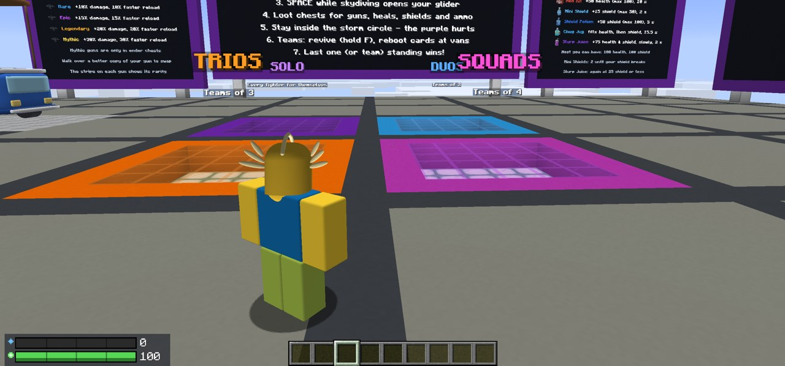
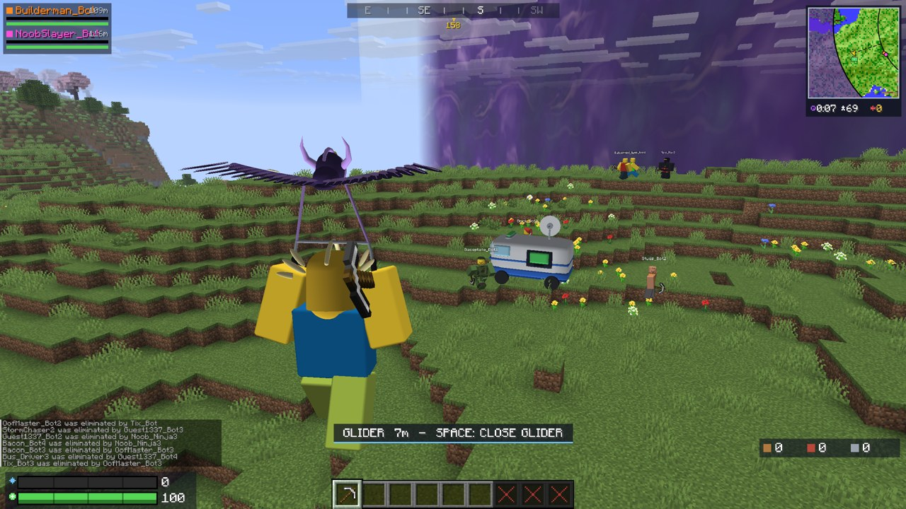
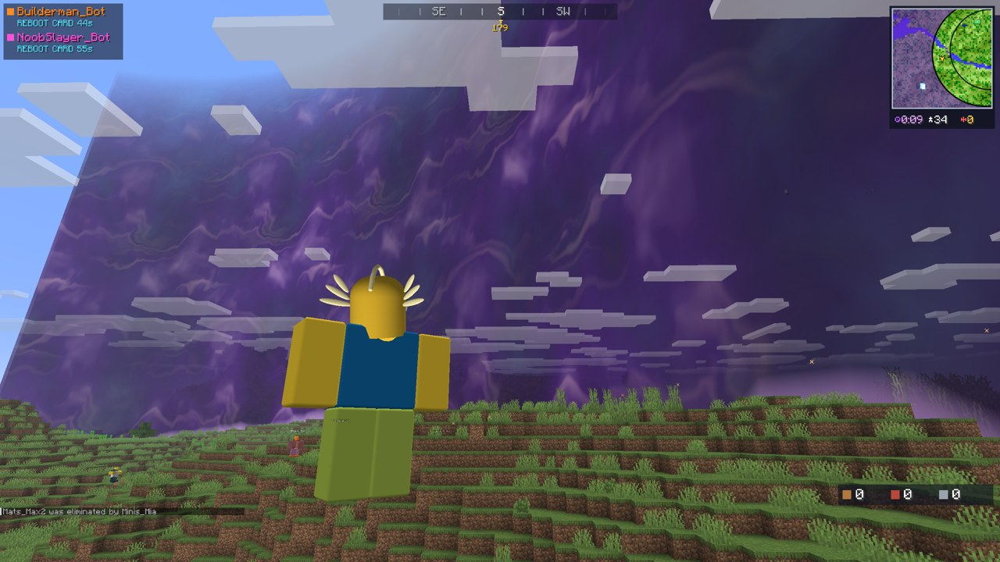
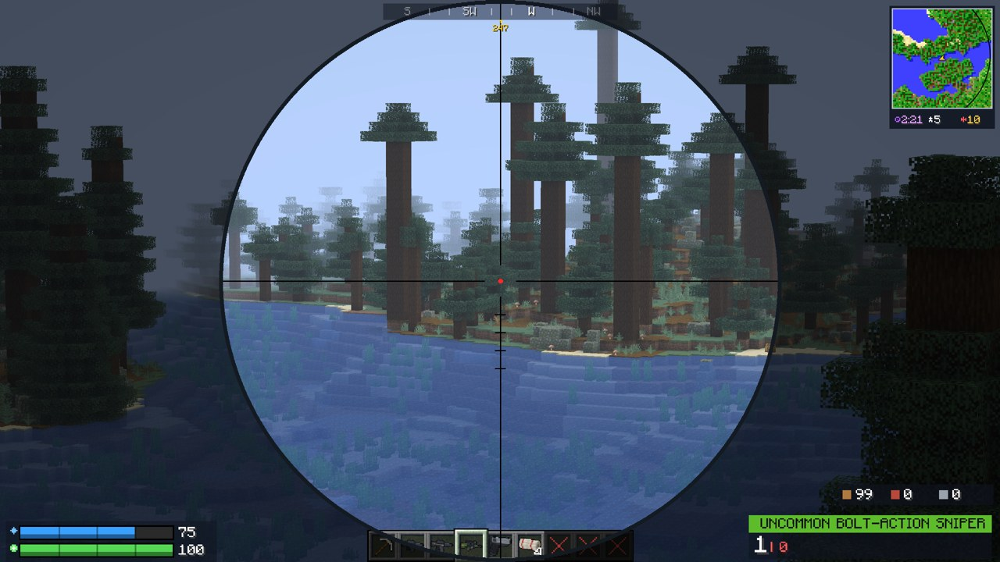
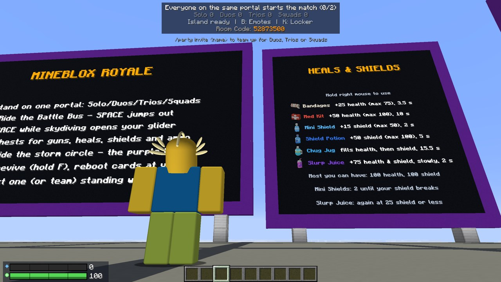
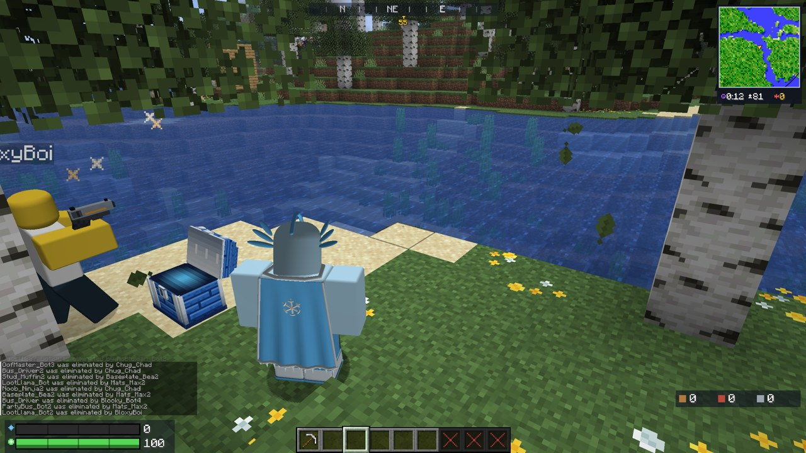
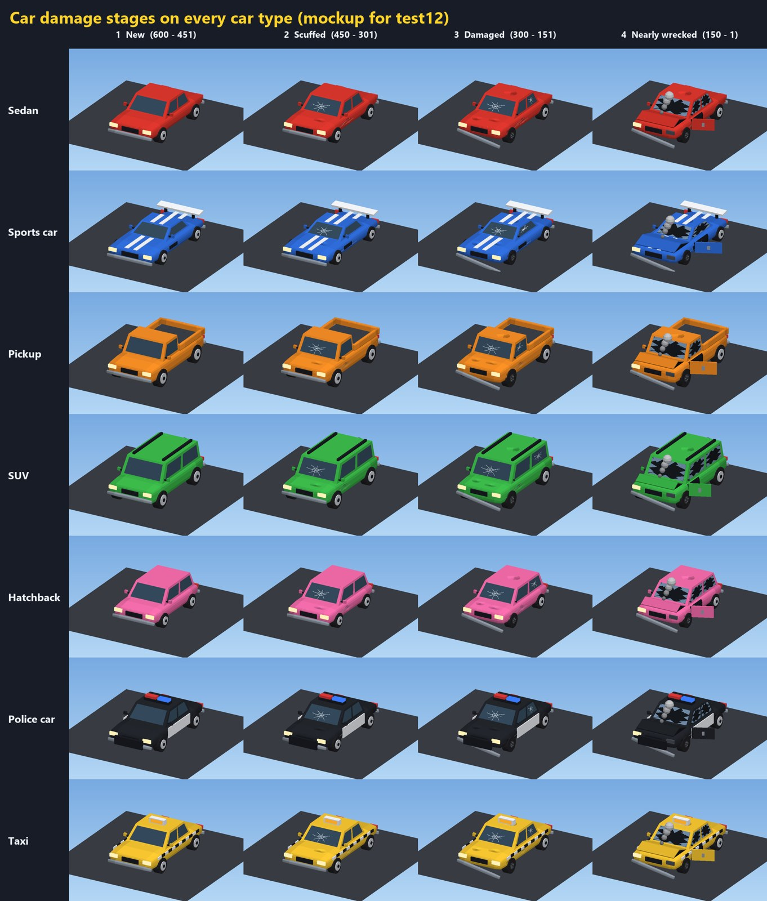

# Mineblox Royale

A battle royale in Minecraft with a Roblox-style hub and Fortnite's rules. Drop from the Battle Bus with up to 100 fighters, loot gold and rare blue chests, build walls and ramps, and outlast the storm. Bots fill every empty place, and they loot, farm, build and fight like players. If Roblox is installed on your PC, everyone gets the Roblox avatar look, outfits, emotes and sounds.

A Minecraft × Roblox × Fortnite mashup for **Minecraft: Java Edition 26.3** (Fabric).

**Play on Melty:** [Mineblox Royale on Melty](https://melty.gg/m/mineblox-royale) installs and starts it in one click.  
**Download:** or pick your launcher's file from the [latest release](../../releases/latest) (see *Install* below).  
**More from me:** [YouTube @Pixelplayz2215](https://www.youtube.com/@Pixelplayz2215)

| Gliding in | The storm | Sniper scope |
|---|---|---|
|  |  |  |
| **Boards in the hub** | **Chests and bots** | **Cars break as you hit them** |
|  |  |  |

## Features

- **Matches of up to 100:** real players plus bots in every empty place, in Solo, Duos, Trios or Squads.
- **Fortnite's flow:**
  - ride the Battle Bus, skydive and open your glider;
  - an 8-phase storm that hits your shield first;
  - the last player or team standing wins a Victory Royale.
- **Loot:**
  - gold chests, and rare blue ones with the best guns: hold **F** to search, and the loot pops out;
  - five guns (Assault Rifle, Pump Shotgun, SMG, Pistol, Bolt-Action Sniper), each from Common to Mythic;
  - Bandages, Med Kits, Mini Shields, Shield Potions, Chug Jugs and Slurp Juice.
- **Sniper scope:**
  - the zoom eases in;
  - you stay scoped through the recoil;
  - hit markers, with a gold one and a bell for headshots;
  - its own sensitivity setting.
- **Building:** walls, floors and ramps in wood, brick or metal.
- **Harvesting:** with the pickaxe, from trees, stone, houses and parked cars. Cars show their damage as you hit them.
- **A new island every match:**
  - about 20 buildings each: shacks, watchtowers, supply depots, ruins, container yards and parking lots full of cars;
  - at least 2 of every kind.
- **Team modes:**
  - parties of up to 4;
  - knocked and revived (hold **F**);
  - reboot cards and reboot vans;
  - teammate colours, waypoints and a team panel.
- **The hub:**
  - mode portals, an obby and the Sky Tower;
  - a shooting range with timed rounds;
  - boards for guns, heals and the rules, and a leaderboard.
- **Locker (K):**
  - Roblox-style outfits, hats, faces, back bling, emotes, gliders and particles;
  - unlocked by eliminations, wins, the obby and the shooting range;
  - your unlocks go with you into every world.
- **Bots that play:**
  - they search chests, heal, farm materials and swim;
  - they build cover when shot, ramp up or do 90s to reach you, and box up to heal;
  - they revive teammates and take reboot cards to vans.
- **Play with friends:** room codes (`/rc`) through a free relay, so there's no port forwarding. Rooms hold up to 16 players.
- **Remade in Blender (v1.0.1):** every gun, heal, car, the Battle Bus, gliders, the pickaxe, chests and every cosmetic, and every animation and emote with bending knees and elbows.

## Install

The easiest way is [Melty](https://melty.gg/m/mineblox-royale): it installs Mineblox Royale and starts it in one click.

Or get a file from the [latest release](../../releases/latest) page. Pick the one for your launcher:

| Launcher | File | How |
|---|---|---|
| **Prism Launcher** (easiest, nothing to install) | [`MinebloxRoyale-1.0.1.4.Prism.Launcher.ready.to.play.zip`](https://github.com/Pixelplayz2215/MinebloxRoyale/releases/latest/download/MinebloxRoyale-1.0.1.4.Prism.Launcher.ready.to.play.zip) | Unzip, run `Prism Launcher\prismlauncher.exe`, add your Microsoft account, double-click *Mineblox Royale*. |
| Prism Launcher (already installed) | [`MinebloxRoyale-1.0.1.4.Prism.Launcher.import.zip`](https://github.com/Pixelplayz2215/MinebloxRoyale/releases/latest/download/MinebloxRoyale-1.0.1.4.Prism.Launcher.import.zip) | Add Instance > Import > choose the file. |
| **CurseForge** | [`MinebloxRoyale-1.0.1.4.CurseForge.zip`](https://github.com/Pixelplayz2215/MinebloxRoyale/releases/latest/download/MinebloxRoyale-1.0.1.4.CurseForge.zip) | Minecraft > My Modpacks > Import > *Import Profile .zip*. |
| **Modrinth App** | [`MinebloxRoyale-1.0.1.4.Modrinth.App.mrpack`](https://github.com/Pixelplayz2215/MinebloxRoyale/releases/latest/download/MinebloxRoyale-1.0.1.4.Modrinth.App.mrpack) | "+" > From file. |
| **Lunar Client** | [`MinebloxRoyale-1.0.1.4.Lunar.Client.mrpack`](https://github.com/Pixelplayz2215/MinebloxRoyale/releases/latest/download/MinebloxRoyale-1.0.1.4.Lunar.Client.mrpack) | Import it as a modpack profile. |
| ATLauncher | [`MinebloxRoyale-1.0.1.4.ATLauncher.mrpack`](https://github.com/Pixelplayz2215/MinebloxRoyale/releases/latest/download/MinebloxRoyale-1.0.1.4.ATLauncher.mrpack) | Import > choose the file. |
| GDLauncher | [`MinebloxRoyale-1.0.1.4.GDLauncher.mrpack`](https://github.com/Pixelplayz2215/MinebloxRoyale/releases/latest/download/MinebloxRoyale-1.0.1.4.GDLauncher.mrpack) | Add instance > Import. |
| MultiMC | [`MinebloxRoyale-1.0.1.4.MultiMC.import.zip`](https://github.com/Pixelplayz2215/MinebloxRoyale/releases/latest/download/MinebloxRoyale-1.0.1.4.MultiMC.import.zip) | Add Instance > Import from zip. |
| **Minecraft Launcher** (Mojang's) or any other | [`MinebloxRoyale-1.0.1.4.Minecraft.Launcher.zip`](https://github.com/Pixelplayz2215/MinebloxRoyale/releases/latest/download/MinebloxRoyale-1.0.1.4.Minecraft.Launcher.zip) | Install [Fabric](https://fabricmc.net/use/installer/) for 26.3, give that installation its own game folder, and copy the zip's `mods` and `minebloxroyale` folders into it. |

- **Downloads:** the `.mrpack` files download Fabric API and e4mc from Modrinth while they import, so be online.
- **First start:** your launcher first downloads Minecraft 26.3 itself from Mojang (about 500 MB, once); leave its progress window open until the game appears. The game then opens straight into your own Mineblox Royale world. Your first island is made in the background during the first few minutes (the hub shows how far along it is), and the obby, the shooting range and the Locker are open meanwhile.
- **Updating:** import the new version's file the same way. Your unlocks and outfit come along.
- **Disk space:** each match is played on a new island; since 1.0.0.4 the islands you've finished with are removed when the world opens, so the world folder stays small. Since 1.0.1.1, when there's less than 1 GB free the next match is played on the same island instead of a new one.

## Controls

| Key | Action |
|---|---|
| Left mouse | Shoot / pickaxe |
| Right mouse | Aim (snipers: scope) |
| R | Reload |
| G | Build mode (walls, floors, ramps) |
| F (hold) | Search a chest / revive a teammate / reboot at a van |
| Tab | Map |
| B | Emotes |
| K | Locker (in the hub) |
| H | Back to the hub once you're out |
| Space | Jump from the Battle Bus; open or close the glider |

Scope too fast? Options > Controls > Mouse Settings > **Scoped Sensitivity**.

## Playing together

- Everyone starts in their own world, their own room.
- The host types `/rc` to see the 8-digit room code, which is also on the hub banner. Friends type `/rc 12345678` to join, and `/leave` takes you back to your own world.
- Party up with `/party invite <name>` and `/party accept`. Everyone in the hub stands on the same mode portal to start the match.
- Everyone who plays together must be on the same version.

## Requirements

- **Minecraft: Java Edition** (your own Microsoft account) and about 8 GB of RAM. Made and tested on Windows.
- **Minecraft 26.3, Fabric Loader 0.19.5 or newer and Java 25.** The launchers set these up for you.
- **Optional:** Roblox installed (avatar look, outfits, emotes and sounds) and Fortnite installed (a poster in the hub). Mineblox Royale only reads a few files from your own copies of those games. It never changes, starts or connects to them, and nothing from them is included here.

## Building from source

- You need JDK 25. In `fabric/`, run `gradlew build`; the mod comes out in `fabric/build/libs/`.
- The design sheets in `design/` (weapons, loot, storm, hub layout, bots...) are the source of truth: `gradlew preflight` checks them, and the build turns them into code.
- `fabric/tools/` holds the model, icon, check and packaging scripts.

## Credits and licences

- Mineblox Royale is released under the MIT licence (see `LICENSE`).
- The downloads also include Fabric API (Apache-2.0), e4mc (MIT) and an LGPL build of FFmpeg, which is used only to decode Roblox sounds from your own install. The Prism download also includes Prism Launcher (GPL-3.0), Microsoft's Visual C++ runtime, which Prism needs, and Java 25 (Mojang's Java runtime for Minecraft, the Microsoft Build of OpenJDK, GPL-2.0 with the Classpath Exception), so the game starts without downloading Java first. Details are in `THIRD-PARTY NOTICES.txt` inside each download.
- Not affiliated with Mojang, Microsoft, Roblox Corporation or Epic Games. Minecraft, Roblox and Fortnite are trademarks of their owners.
